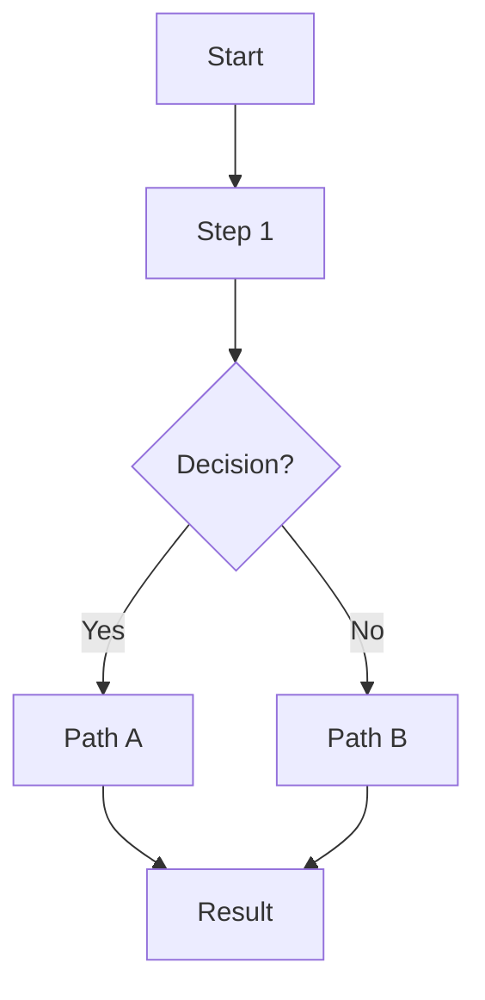
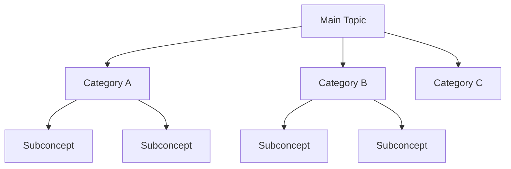
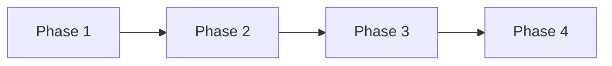
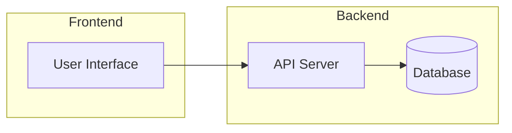
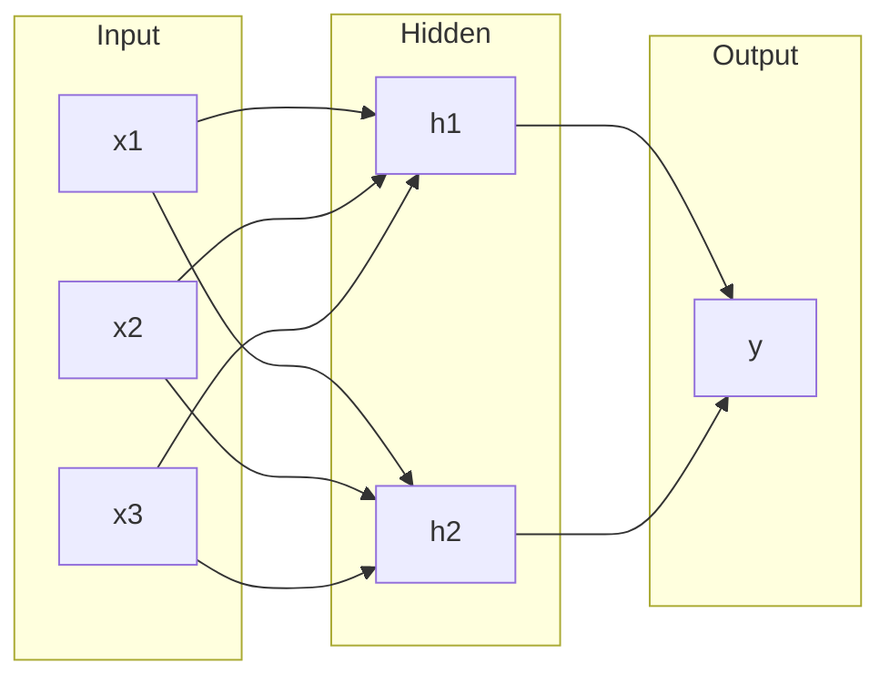
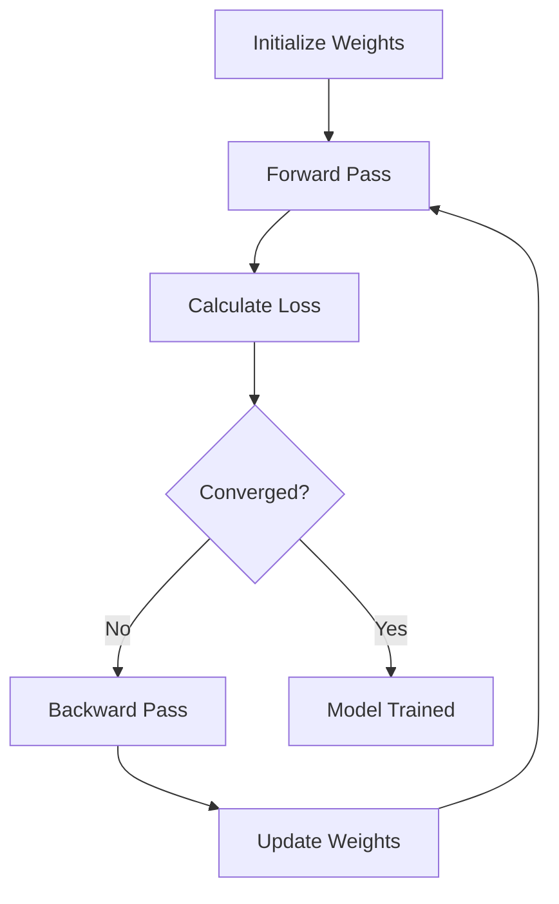
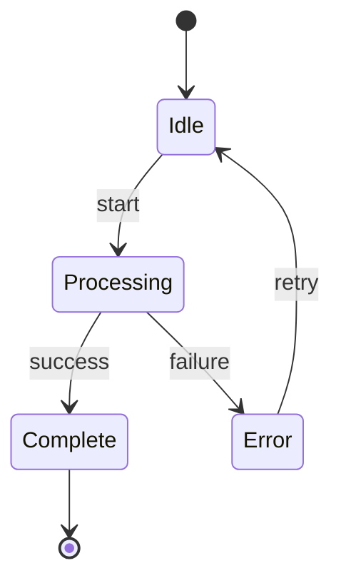
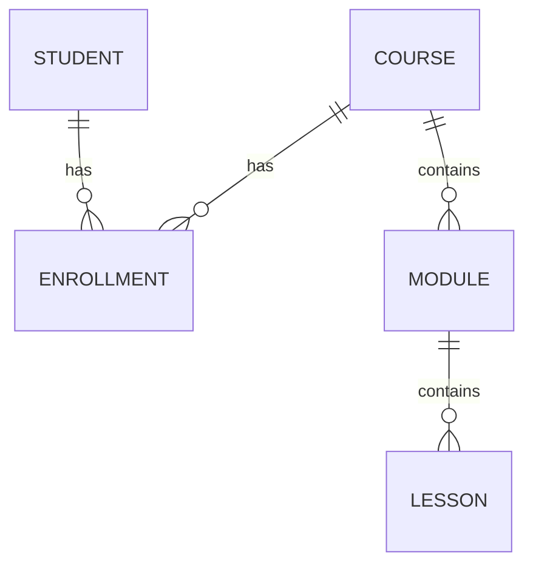

# Visual Patterns Reference

Templates and examples for creating diagrams in course notes. Covers mermaid,
ASCII art, markdown tables, and LaTeX notation across multiple domains.

---

## Mermaid Diagram Templates

### Process Flow (General Purpose)


### Concept Hierarchy


### Timeline / Sequence


### System Architecture


### Neural Network (ML/AI Courses)


### Training Loop (ML/AI Courses)


### State Machine


### Entity Relationship


---

## ASCII Art Templates

### Simple Process Flow
```
[Input] --> [Process] --> [Output]
   ^                         |
   |_____ Feedback Loop _____|
```

### Layer Stack
```
+-----------------+
|   Application   |
+-----------------+
|   Framework     |
+-----------------+
|   Libraries     |
+-----------------+
|   Runtime       |
+-----------------+
```

### Decision Tree
```
         Root
        /    \
   Feature1  Feature2
    /    \     /    \
  Yes    No  Yes    No
```

### Pipeline
```
Raw Data --> Clean --> Transform --> Model --> Evaluate --> Deploy
```

### Comparison Layout
```
  Option A          Option B
+-----------+    +-----------+
| Fast      |    | Thorough  |
| Simple    |    | Complex   |
| Less safe |    | More safe |
+-----------+    +-----------+
```

---

## Markdown Table Templates

### Feature Comparison
| Feature | Option A | Option B | Option C |
|---------|----------|----------|----------|
| Speed | Fast | Medium | Slow |
| Accuracy | Low | Medium | High |
| Cost | Free | $ | $$$ |

### Algorithm Comparison (CS Courses)
| Algorithm | Time | Space | Use Case |
|-----------|------|-------|----------|
| Linear Search | O(n) | O(1) | Unsorted data |
| Binary Search | O(log n) | O(1) | Sorted data |
| Hash Table | O(1) avg | O(n) | Fast lookup |

### Hyperparameter Guide (ML Courses)
| Parameter | Range | Default | Effect |
|-----------|-------|---------|--------|
| Learning Rate | 0.001-0.1 | 0.01 | Controls step size |
| Batch Size | 16-256 | 32 | Affects gradient noise |
| Epochs | 10-1000 | 100 | Training iterations |

### Metrics Overview
| Metric | Formula | Range | Best For |
|--------|---------|-------|----------|
| Accuracy | TP+TN/Total | [0,1] | Balanced datasets |
| Precision | TP/(TP+FP) | [0,1] | False positive critical |
| Recall | TP/(TP+FN) | [0,1] | False negative critical |

### Pros and Cons
| Pros | Cons |
|------|------|
| [Advantage 1] | [Disadvantage 1] |
| [Advantage 2] | [Disadvantage 2] |

### Historical Timeline (Humanities Courses)
| Year | Event | Significance |
|------|-------|-------------|
| [Date] | [What happened] | [Why it matters] |

### Framework Comparison (Business Courses)
| Framework | Best For | Limitations | Key Insight |
|-----------|----------|-------------|-------------|
| Porter's 5 Forces | Industry analysis | Static snapshot | Competitive pressure |
| SWOT | Strategic planning | Subjective | Internal + external |
| BCG Matrix | Portfolio mgmt | Oversimplifies | Growth vs share |

---

## LaTeX Math Notation

### Common ML Formulas
**Loss Functions:**
- MSE: `$L = \frac{1}{n}\sum_{i=1}^{n}(y_i - \hat{y}_i)^2$`
- Cross-Entropy: `$L = -\sum_{i} y_i \log(\hat{y}_i)$`

**Activation Functions:**
- Sigmoid: `$\sigma(x) = \frac{1}{1 + e^{-x}}$`
- ReLU: `$f(x) = \max(0, x)$`
- Tanh: `$\tanh(x) = \frac{e^x - e^{-x}}{e^x + e^{-x}}$`

**Gradient Descent:**
- Update rule: `$w_{new} = w_{old} - \alpha \nabla L$`

### General Math
**Statistics:**
- Mean: `$\bar{x} = \frac{1}{n}\sum_{i=1}^{n} x_i$`
- Standard deviation: `$\sigma = \sqrt{\frac{1}{n}\sum_{i=1}^{n}(x_i - \bar{x})^2}$`
- Bayes' theorem: `$P(A|B) = \frac{P(B|A) \cdot P(A)}{P(B)}$`

**Calculus:**
- Derivative: `$f'(x) = \lim_{h \to 0} \frac{f(x+h) - f(x)}{h}$`
- Integration: `$\int_{a}^{b} f(x) \, dx$`

**Linear Algebra:**
- Dot product: `$\mathbf{a} \cdot \mathbf{b} = \sum_{i=1}^{n} a_i b_i$`
- Matrix multiply: `$C_{ij} = \sum_{k} A_{ik} B_{kj}$`

---

## When to Use Each Visualization

| Concept Type | Best Visual | Alternative |
|-------------|-------------|-------------|
| Process / workflow | Mermaid flowchart | ASCII flow |
| Architecture | Mermaid graph | ASCII boxes |
| Comparisons | Markdown table | Side-by-side lists |
| Hierarchies | Mermaid tree | Indented lists |
| Mathematical | LaTeX notation | Code blocks |
| Timelines | Mermaid flowchart LR | Numbered list |
| Relationships | Mermaid ER diagram | ASCII arrows |
| State transitions | Mermaid stateDiagram | Table of states |

## Quick Visual Decision Tree

1. **Does it show a sequence?** — Flowchart
2. **Does it compare items?** — Table
3. **Does it show structure?** — Graph / Tree
4. **Is it mathematical?** — LaTeX
5. **Does it show states?** — State diagram
6. **Is it simple / inline?** — ASCII art
7. **Default** — Bullet points with indentation
