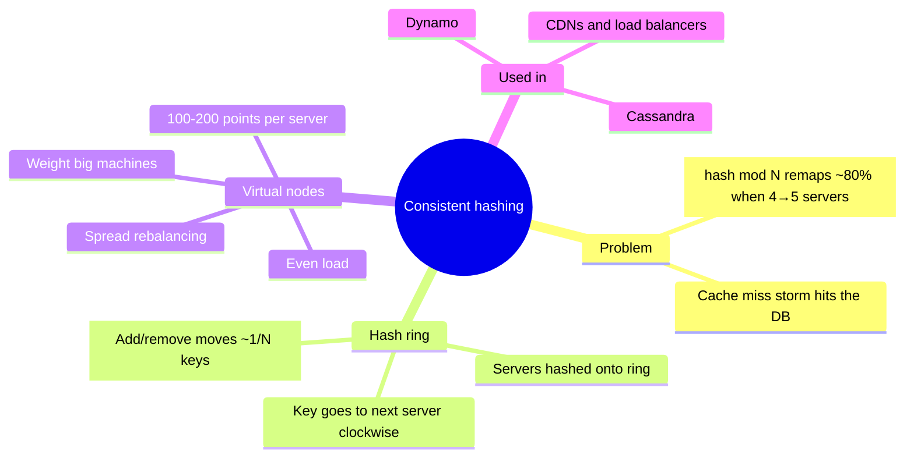
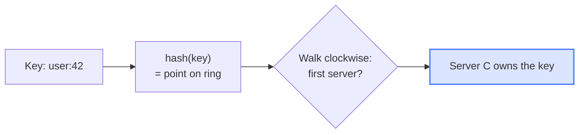
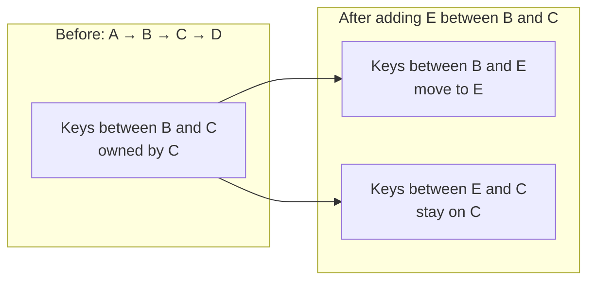

# Consistent Hashing

> [!abstract] TL;DR
> - Assigning keys with `hash(key) mod N` breaks badly when N changes: going from 4 to 5 servers moves roughly **80% of keys**.
> - Consistent hashing puts servers and keys on a **ring** of hash values; each key belongs to the **first server clockwise** from it.
> - Adding or removing a server moves only the keys in **one arc**, on average **~1/N of all keys**.
> - With few servers the arcs are uneven, so some servers get far more load. **Virtual nodes** (100–200 points per server) even this out.
> - Used by Amazon's Dynamo, Cassandra, CDNs and load balancers.

## Why this matters

In a cache cluster, the server for a key is usually chosen by a function of the key. The simple choice, `hash(key) mod N`, ties every key's placement to the **number of servers**. When you add or remove one server, almost every key maps somewhere new. For a cache that means a burst of misses, all falling through to the database at the same moment. Consistent hashing removes that dependency on N, so the cluster can grow or shrink while most keys stay where they are.

## Big picture

Read it left to right: the problem (mod N) leads to the ring idea, the ring has one weakness (uneven arcs), and virtual nodes fix that weakness.

## Core concepts

### Modulo hashing and why it fails

**What it is:** pick the server for a key with `server = hash(key) mod N`.

**Intuition:** like dealing cards round-robin into N piles. Change the number of piles and nearly every card ends up in a different pile.

**Details:** with 4 servers, `hash(key) mod 4` spreads keys evenly. Add a fifth and the formula becomes `mod 5`, which gives a different answer for most keys, so roughly 80% of keys move.

> [!info] Added context
> Where the 80% comes from: a key keeps its server only if `h mod 4 == h mod 5`. Among any 20 consecutive hash values, that is true for just 4 of them (h mod 20 = 0, 1, 2, 3), so about 20% stay and **80% move**.

### The hash ring

**What it is:** take the hash function's whole output range, 0 to 2³², and join the ends into a circle.

**Intuition:** a round table with seats (servers) at fixed points. Each guest (key) sits down and gives their order to the next waiter clockwise.

**Details:**
- Each server's **name** is hashed to give it a position on the ring.
- To find a key's server: hash the key, then **walk clockwise** to the first server.
- So each server owns the arc between the previous server and itself.

### Adding and removing servers

**Adding:** put a new server E between B and C. Only keys whose position falls **between B and E** change owner, moving from C to E. Every other key stays put.

**Removing:** symmetric. The leaving server's keys move to the **next server clockwise**.

**Result:** on average only **1/N of keys move**, compared with nearly all of them under mod N.

[[Consistent Hashing - interactive.html|▶ Open the interactive walkthrough]] (step through keys moving when server E joins)

### Virtual nodes

**The catch:** with only a few servers, their hash positions land unevenly. One server can end up owning a huge arc, and therefore most of the load.

**The fix:** hash each physical server **many times**, typically 100–200, so it appears as many small arcs spread around the ring.

**Why it works:**
- **Even load:** lots of small arcs average out, so each server owns roughly its fair share.
- **Gentle rebalancing:** when a server leaves, its many small arcs go to many different neighbours instead of piling onto one.
- **Weighting:** give a bigger machine more virtual nodes and it takes a proportionally bigger share.

## Worked examples

**Scaling a 4-node cache to 5 nodes, with 1,000,000 cached keys:**

| Scheme | Keys that move | What the database sees |
|---|---|---|
| `hash(key) mod N` | ~800,000 (~80%) | a sudden miss storm |
| Hash ring | ~200,000 (≈1/5, the new server's share) | a small, contained bump |
| Ring + virtual nodes | ~200,000, taken evenly from all 4 old servers | the same small bump, spread out |

> [!info] Added context
> With N servers after the change, the new server takes about 1/N of the keyspace, here 1/5 = 20%. That is the same "1/N" the video quotes.

## Comparisons and trade-offs

| | Modulo hashing | Ring (no virtual nodes) | Ring + virtual nodes |
|---|---|---|---|
| Keys moved when N changes | almost all | ~1/N (one arc) | ~1/N, spread out |
| Load balance | even | can be very uneven | even |
| Who absorbs a removed server's keys | everyone (full reshuffle) | one neighbour | many servers |
| Supports weighted servers | no | no | yes (more virtual nodes) |
| Complexity | trivial | moderate | moderate (more ring entries) |

**Choose when:** modulo is fine if N never changes. Use a ring with virtual nodes for any cluster that grows, shrinks or loses machines.

## Pitfalls and misconceptions

- **"The ring alone balances load."** It doesn't. With few servers the arcs are uneven, and virtual nodes are what fix that.
- **Removing a server without virtual nodes** dumps all its keys onto a single neighbour, which can overload it.
- **"Consistent hashing means no keys move."** Some always move (~1/N); the point is that it's the minimum necessary.

## Key takeaways and mental models

- Placement should depend on **where things sit on the ring**, not on **how many servers exist**.
- "Next server clockwise" is the whole lookup rule.
- Change cost ≈ **1/N** of keys, compared with ≈ all keys for mod N.
- **Virtual nodes = balance + gentle failure + weighting.**

## Glossary

| Term | Meaning |
|---|---|
| Hash ring | The hash output range (0 to 2³²) treated as a circle |
| Arc | The stretch of ring a server owns: from the previous server up to itself |
| Virtual node | One of the many ring positions given to a single physical server |
| Rebalancing | Keys changing owner after servers join or leave |

## Related

- [[Caching]] · [[Cache Stampede]] · [[Sharding]] · [[Load Balancing]] · [[Dynamo]] · [[Cassandra]]
- Original paper (from the video description): https://www.cs.princeton.edu/courses/archive/fall09/cos518/papers/chash.pdf

## Source

- Video: [Consistent Hashing Explained (TEST FIXTURE - not a real video)](https://www.youtube.com/watch?v=TEST0000001) · Test Channel · 2026-01-15 · 9:00
- [[transcript - TEST0000001|Full transcript]] · test fixture, manual captions
