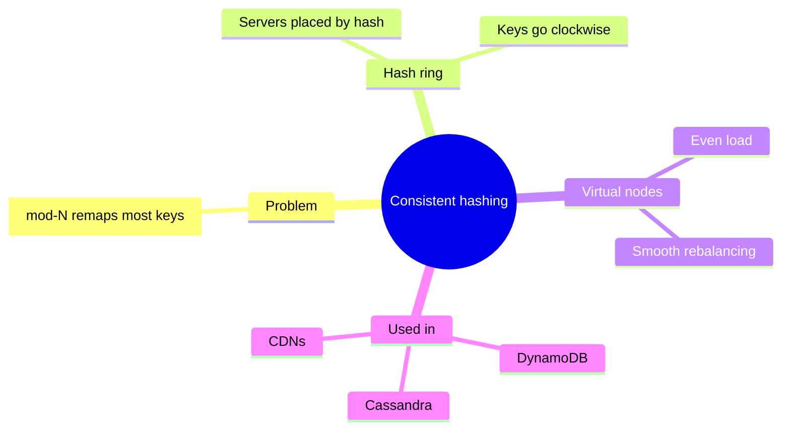
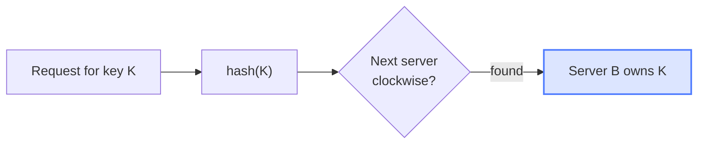
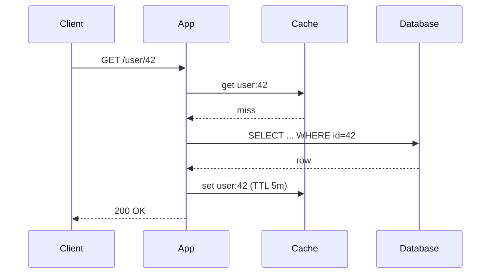
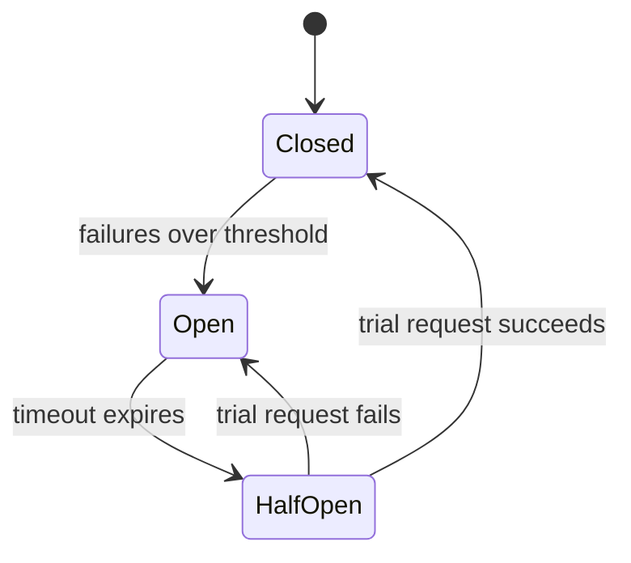
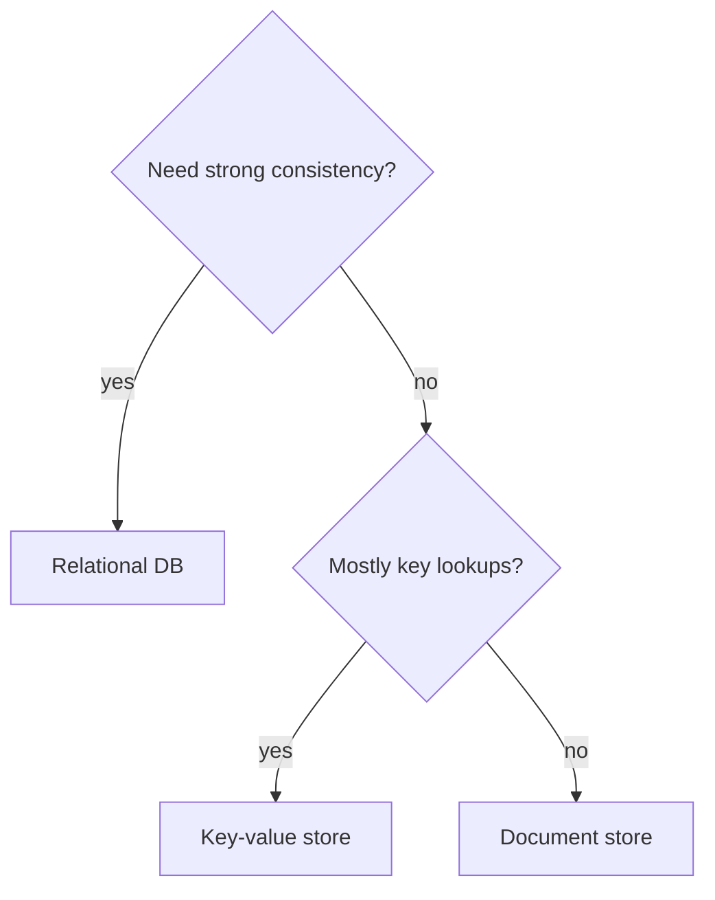

# Visuals for notes

Visuals exist to make an idea click faster than prose would. Each diagram should answer one question ("how does a request flow?", "what are the states?"). Put it right next to the text it explains, with a sentence on how to read it.

## Choosing a visual

| Content in the video | Best visual |
|---|---|
| Overall map of a topic, how its parts relate | `mindmap` or `flowchart TD` (Big picture) |
| A process, pipeline or algorithm's steps | `flowchart LR` / `TD` |
| Components talking to each other over time (request/response, protocols) | `sequenceDiagram` |
| Something with states and transitions (lifecycle, TCP, circuit breaker) | `stateDiagram-v2` |
| Architecture: services, stores, queues | `flowchart LR` with `subgraph`s per layer or zone |
| Decision guide ("which DB should I use?") | `flowchart TD` with diamond decisions |
| Classes, data models, relationships | `classDiagram` / `erDiagram` |
| History, phases, evolution | `timeline` |
| Comparing options on criteria | a **markdown table** (not a diagram) |
| Two-axis positioning (cost vs. latency) | `quadrantChart` |
| Numbers, proportions | table first; `pie` only for a few parts of a whole |
| Something that moves or changes step by step | an **interactive HTML** walkthrough (see interactive-html.md) |

Aim for 3–6 diagrams in a deep note: a Big picture plus one per major mechanism. Don't add a diagram that just restates a list.

## Obsidian-safe Mermaid rules

Obsidian ships its own Mermaid version, which is often behind the latest. Breaking these rules gives "Syntax error" in the note.

1. **Stick to stable diagram types**: flowchart, sequenceDiagram, classDiagram, stateDiagram-v2, erDiagram, gantt, pie, mindmap, timeline, quadrantChart, gitGraph. Avoid `block-beta`, `architecture-beta`, `packet-beta`, `kanban` and other `-beta` types.
2. **Quote labels that have punctuation**: `A["Load balancer (L7)"]`, `B{"Cache hit?"}`. Parentheses, colons, commas, `#`, `&`, quotes and slashes inside unquoted labels break parsing. For a literal quote inside a label, use `#quot;`.
3. **Simple node IDs**: letters, digits and underscores only (`api_gw`, not `api-gw` or `API GW`). Never use `end` as an ID, and don't start one with `o` or `x` right after `---` (`A---oB` draws a circle).
4. **Line breaks** inside labels: `<br>`. No other HTML, and no markdown inside labels.
5. **Edge labels**: `A -->|"writes"| B`.
6. **Subgraphs**: `subgraph data["Data layer"]` … `end`.
7. **Keep it small**: about 12–15 nodes max. Split big pictures into an overview plus detail diagrams.
8. **Don't hard-code colours that only work on one theme.** If you emphasise something, use one `classDef` with a mid-tone fill that reads on light and dark, e.g.
   `classDef key fill:#4f7cff33,stroke:#4f7cff,stroke-width:2px` then `class cache key`.
9. **No `click` handlers** and no `%%{init}%%` theme overrides, so the user's Obsidian theme applies.
10. **mindmap**: indentation defines the tree. Use plain text nodes, quoted with `["..."]` if they have punctuation.

## Patterns

**Big picture (mindmap)**


**Process (flowchart)**


**Interaction over time (sequence)**


**States**


**Decision guide**


## Other visual patterns that work well in markdown

- **Comparison tables** with a final "Choose when…" row.
- **Before / after** pairs: two small code blocks or diagrams showing the change.
- **Annotated code**: a short block followed by numbered explanations (`1.` maps to line X).
- **ASCII sketches** for things Mermaid can't draw well (memory layouts, arrays, bit fields), inside a plain ``` block:
  ```
  index:  0   1   2   3   4
  heap : [9] [7] [8] [3] [5]
  ```
- **Callouts** for emphasis: `> [!tip]`, `> [!warning]`, `> [!example]`, `> [!question]` (for "think about it" prompts, used sparingly).
- **Formula blocks** with LaTeX (`$$ ... $$`), which Obsidian renders.
